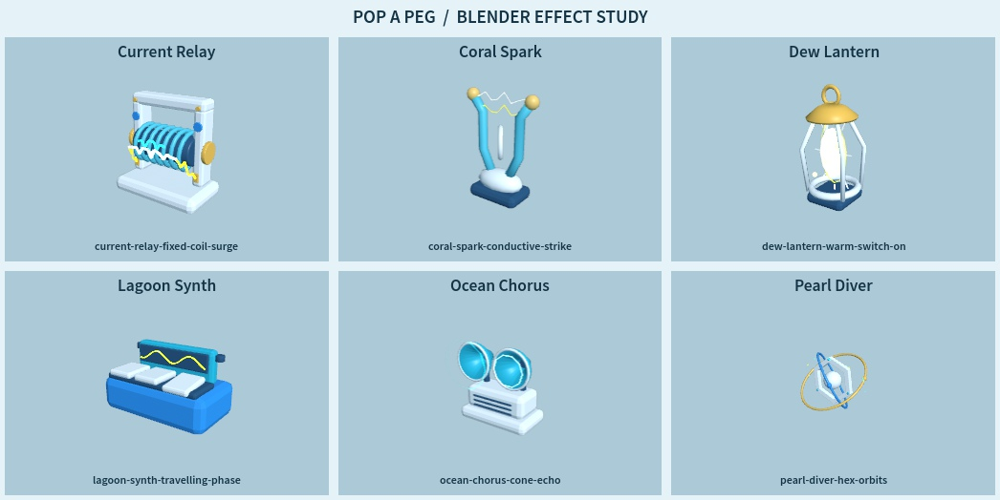
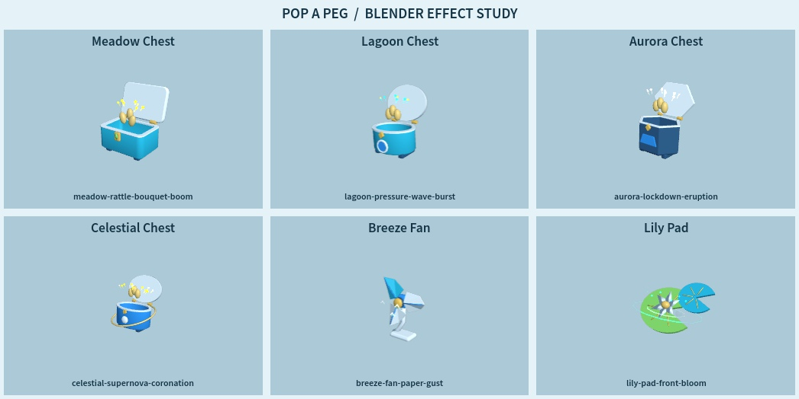

# RBX-027 Studio review

Reviewed 2026-11-08. Scope: Blender catalog, gallery choreography, transient effects
and gallery sound. Native geometry, native animation, all `src/` and the default
game project remain unchanged from accepted source
`07be76a57335fa3aaa05009c91bd2e36ed05dd0e`.

## Delivered treatments

- Eight revised Blender sources: Landing Shell, Lily Pad, Breeze Fan, Ozone Orb,
  Pearl Diver, Current Relay, Soft Current and Lagoon Synth.
- Coral Spark and Breeze Fan have gallery display names; stable IDs and historical
  upload metadata remain intact.
- Eleven requested mechanism treatments, 16 additional mechanism refinements and
  78 distinct transient effect profiles. Functional emitters follow the posed
  geometry; effects restore at rest and can be disabled.
- 78 authored sound phrases across 12 timbre families and a 45-semitone register,
  with different rhythms, envelopes, pitch motion and harmonic layers.
- [All-item treatment reference](../../MODEL_TREATMENTS.md).
  [Gallery controls](../../CATALOG_GALLERY.md).

## Executed evidence

Initial implementation: `9f0a5b9e7984fbca1cca75d22d65b6f1c22832ed`.
Final runtime source: `7f7339bd3bacb427a840ed43bb2295fd6eae32f3`.
The only runtime change between them exposes the relay discharge in front of its
opaque winding. The first render review caught that occlusion; the corrected
relay was visually rechecked and its camera fit passed again.

| Check | Observed result |
| --- | --- |
| Required local checks | Formatting/lint; 23 gameplay suites; 78 motion profiles; 12,792 deterministic effect samples; gallery audio lifecycle and 78 instrument phrases; three builds; 45 game source mappings; documentation links |
| Import/archive validation | 78 models, 477 MeshParts, 127664 triangles; 12 archived uploads; exact source/GLB/raw/receipt hashes; eight corruption-regression tests |
| Native freeze | Eight explicit native hash guards; complete src/default project diff empty |
| Studio imported motion | 78/78 loaded and passed bounded motion, restoration and articulation checks |
| Studio effects, final source | 78/78; 3,276 samples at strengths 1 and 2; fixed 40-part pools, deterministic poses, endpoints, bounds and cleanup |
| Camera, initial source | All78; 121,056 visible geometry/effect corners inside frame at strength2; minimum margin 8.69% |
| Camera, final relay | 3,360 corners; minimum margin 9.81% |
| Audio | All78 loaded, playing, advancing time and producing nonzero output loudness; bounded voices/gain and disposal passed |
| Previous press/cap mechanics | Four native/Blender assemblies, 808 poses, 10,806 assertions passed |
| Real GUI controls | Trigger starts audio; paused pose stayed exactly0.1329978922 over0.3s; resume advances; FX OFF hides every pool part |
| Source identity | 28 built gallery scripts match Studio normalized UTF-8 byte counts and rolling hashes |

[Raw Studio results](studio-audits.json) and
[build/source verification](source-verification.json) retain the exact observations.
The review covered all78 rendered activation poses across
[pages01](page-01.jpg), [02](page-02.jpg), [03](page-03.jpg), [04](page-04.jpg),
[05](page-05.jpg), [06](page-06.jpg), [07](page-07.jpg), [08](page-08.jpg),
[09](page-09.jpg), [10](page-10.jpg), [11](page-11.jpg), [12](page-12.jpg)
and [13](page-13.jpg), plus named-item and late-chest poses.
Contact sheets are static review evidence, not a recording of every frame.

## Artifact and boundaries

Final build: `build/peg-blender-effects.rbxlx`.
SHA256: `12366dd766e60bc83fbd659ace0895d15367babfa48f53957072e3ecbc90f5de`.

Studio target `9f7afcd3-3f7d-45ea-8f2d-9769db7f8564`
(`peg-catalog-gallery-final.rbxlx`) was staged with the exact final source and
runtime models and stopped in Edit. No Rojo connection. Attempts to open another
instance encountered Studio's instance-count warning; the final build's script
contents were compared to the tested session instead. The prior user gallery
`4a95dbcb` and saved experience were preserved.

Original model asset `107372484175276` returned Approved for owner583716264.
That is asset upload, not experience publication. No new audio assets or textures.
No subjective listening approval is claimed; real playback/output was verified.
The existing avatar asset203785492 type warning remains; no new script errors
were observed.
